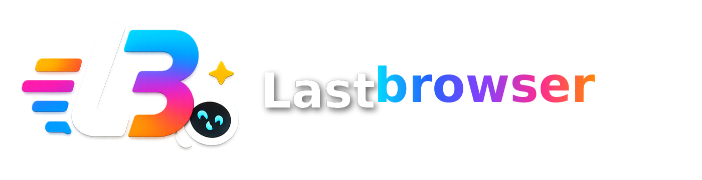
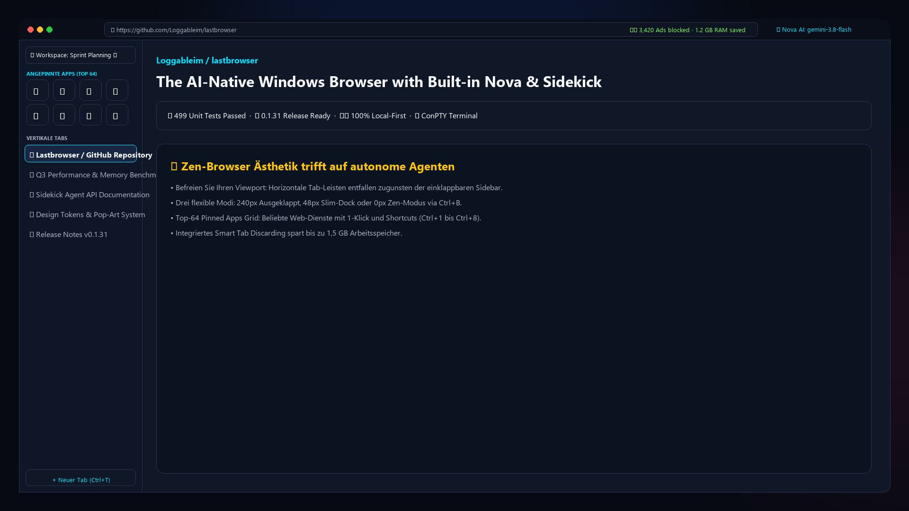
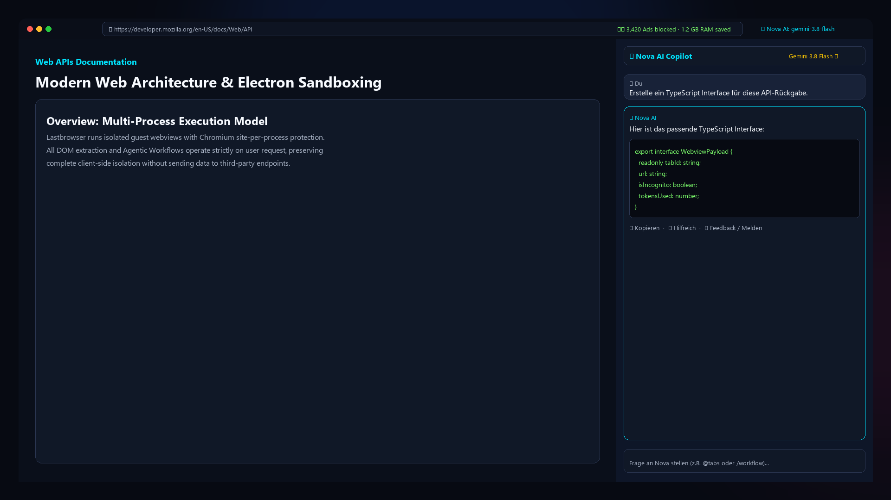

<div align="center">
  
  <h1>Lastbrowser</h1>
  <p><strong>A desktop browser with Sidekick in your workspace.</strong></p>
  <p>Browse the web, organize work in Spaces and profiles, and bring Sidekick alongside your tabs.</p>
  <p>
    <a href="https://github.com/Loggableim/lastbrowser/releases/latest">Download the published stable release</a>
    · <a href="docs/release.md">Release and installation notes</a>
    · <a href="apps/desktop/README.md">Desktop architecture</a>
  </p>
</div>

Lastbrowser is a Windows-first Electron browser shell with Sidekick integrated as a first-class browser sidebar. It is seeded from the Hermes Portable codebase, but the public product surface is Lastbrowser and Sidekick.

## See the browser

These product images show the browser shell and integrated Sidekick interface.

| Browser workspace | Sidekick alongside a page |
|---|---|
|  |  |

## What it includes

- **Browser workspace:** Tabs and web pages organized in Spaces and switchable browser profiles.
- **Sidekick alongside your tabs:** Chat and browser-aware assistance with configured providers and models.
- **Provider choice:** Supported providers may require a separately configured account or API key.
- **Local components:** The browser shell and Sidekick service run on your computer. Requests to configured remote providers go to those providers.

Feature availability depends on the selected mode, provider setup and release. Check the published release notes before installing.

## Install

Open the [published stable release](https://github.com/Loggableim/lastbrowser/releases/latest), choose an artifact for your operating system from its assets, and review its installation notes. Windows releases offer an installer and a portable build. Other platform downloads are available only when explicitly provided in that release.

Draft test candidates are not published stable releases. See [all releases](https://github.com/Loggableim/lastbrowser/releases) for release history.

## Structure

- `apps/desktop` - Electron, TypeScript, Vite and React browser shell (`src/main/` and `src/renderer/`).
- `services/sidekick` - In-tree Sidekick Python backend engine, FastAPI server, CLI tools, runtime & skills.
- `assets/store` - Microsoft Store certification asset pack (512/1024 icons, 1920x1080 screenshots).
- `brand` - Vector brand assets, icons, and logos.
- `docs` - Technical architecture, Microsoft Store listing metadata, and release planning.
- `lastbrowser.com` - Official product landing page, GDPR/Store privacy policy, and support portal.

## Development & Verification

```powershell
npm install
npm test                  # Unit and integration tests
npm run verify:store      # Automated Microsoft Store release readiness preflight
npm run build             # Build main TypeScript and renderer Vite bundles
```

For local UI work, run the renderer and Electron separately:

```powershell
npm run dev
npm --workspace apps/desktop run start:dev
```

## Architecture Notes

- Lastbrowser is a **fully integrated Monorepo**: `services/sidekick` is maintained in-tree as the native Python engine.
- See [`AGENTS.md`](./AGENTS.md) and [`GEMINI.md`](./GEMINI.md) for mandatory agent conventions and workflow boundaries.
- Offline-ready: Builds and packaging do not depend on external repository syncing.

## Getting started

- [Desktop app overview](apps/desktop/README.md)
- [Release flow and Windows artifacts](docs/release.md)
- [Developer guide: MCP and browser architecture](docs/MCP_DEVELOPER_GUIDE.md)
- [Built-in Sidekick service](services/sidekick/README.md)

## Licensing and attribution

Eligible original LastBrowser material in this repository is offered under **GPL-3.0-only** where [LICENSE-SCOPE.md](LICENSE-SCOPE.md) applies. The root [LICENSE](LICENSE) is the unmodified GPL-3.0 text; it does not relicense the whole monorepo.

- [NOTICE](NOTICE) and [THIRD-PARTY-LICENSES.md](THIRD-PARTY-LICENSES.md) — A-022 draft inventory and distribution notices (work in progress).
- [Sidekick license](services/sidekick/LICENSE), [xterm provenance](apps/desktop/src/renderer/vendor/xterm/PROVENANCE.md), and other in-tree component notices.
- Public product and privacy copy: [lastbrowser.com](https://lastbrowser.com/) (separate site repo).

Preserve upstream license files when redistributing. This README does not grant rights beyond the applicable component licenses.

