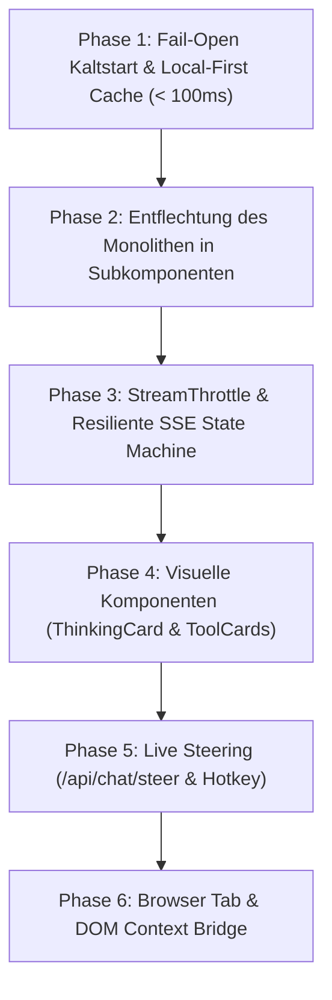

# Analyse & Umsetzungsplan A-017: Modulares Portierungs- und Modernisierungsprogramm für den Lastbrowser Chat

> **Auftrag:** A-017 (Abschluss des 4-stufigen Programms „Chat modernisieren & stabilisieren“)  
> **Typ:** Implementierungs- und Portierungsarchitektur, Phasenplan & Schnittstellen-Spezifikation  
> **Status:** Bereit zur Umsetzung (Release-Fahrplan v0.1.53+)  
> **Datum:** 11. Oktober 2026  
> **Autor:** `antigravity-worker-6` (Bug-Kurator und Bugsucher)  
> **Bezug:** Baut auf [A-014 (Sidekick-Architektur)](file:///c:/projekte/lastbrowser/docs/analysis/A-014-sidekick-chat.md), [A-015 (Lastbrowser-Istzustand)](file:///c:/projekte/lastbrowser/docs/analysis/A-015-lastbrowser-chat-istzustand.md) und [A-016 (Externe Vorbilder & Best Practices)](file:///c:/projekte/lastbrowser/docs/analysis/A-016-chat-vorbilder-best-practices.md) auf.  

---

## 1. Executive Summary & Zielbild

Die Bestandsaufnahmen in **A-014** und **A-015** sowie der Industrie-Benchmark in **A-016** haben gezeigt:
Lastbrowser besitzt im Python-Backend (`services/sidekick/`) ein hochentwickeltes, schnelles und feature-reiches Agenten-Fundament (FastAPI, SSE-Streaming, Tool Execution, Hardware Ticker, Memory-Extraktion und Steering-Endpunkte). Im Frontend (`apps/desktop/src/renderer/`) hingegen ist der Chat-Bereich in einem 939-Zeilen-Monolithen (`NativeChatMain.tsx`) gefangen, der durch veraltete HTML-Strukturen (`<details>`), ungedrosseltes Token-Streaming und synchrone Koppelung an Uvicorn (Kaltstart-Latenz bis zu 30 s) das Nutzungserlebnis einschränkt.

**Ziel von A-017:**  
Ein modularer, risikominimierter und schrittweise umsetzbarer **Portierungs- und Implementierungsplan**, der:
1. Den Chat-Komponentenbaum in saubere, testbare Einzelmodule entflechtet.
2. Den Kaltstart durch eine *Fail-Open Local-First*-Strategie (< 100 ms Renderzeit) entkoppelt.
3. Die drei Kernmuster aus A-016 einführt:
   - **`ThinkingCard`:** Animierte, einklappbare Denkprozess-Karte mit Stoppuhr und Shimmer.
   - **`StreamThrottle`:** 60-Hz `requestAnimationFrame`-Token-Buffer zur Vermeidung von DOM-Ruckeln.
   - **`ComposerSteering`:** Live-Korrektur laufender Antworten via `/api/chat/steer` und `Ctrl+Shift+Enter`.
4. Resiliente Session- und Abbruchbehandlung (`isPartial: true`) sicherstellt.
5. Volle Integration mit Browser-Tabs und aktiver Seiten-Extraktion ermöglicht.

---

## 2. Architektur-Zielbild (Soll-Komponentenbaum)

Statt eines 939-zeiligen Monolithen wird das Chat-Subsystem modular strukturiert:

```
apps/desktop/src/renderer/components/chat/
├── NativeChatMain.tsx             # Schlanker Orchestrator (< 150 Zeilen)
├── hooks/
│   ├── useChatSession.ts          # State-Machine: Sessions, History, Local-First Sync
│   ├── useChatStreaming.ts        # SSE EventSource, StreamThrottle (60 Hz RAF), Abort/Steer
│   ├── useModelSelection.ts       # Model-Katalog, Fallbacks, Routing
│   └── useTabContextBridge.ts     # Auslesen aktiver Browser-Tabs & DOM-Kontext
├── components/
│   ├── ChatHeader.tsx             # Titel, Model-Picker, Hardware-Status-Ticker, Actions
│   ├── ChatTranscript.tsx         # Virtualisierte Nachrichtenliste & Auto-Scroll
│   ├── ChatMessageItem.tsx        # Einzelnachricht (User / Assistant / System)
│   ├── ThinkingCard.tsx           # Animiertes Accordion für Denkprozesse (<think>)
│   ├── ToolExecutionCard.tsx      # Visuelle Tool-Calls (Karten mit Status & Diff)
│   ├── ChatComposer.tsx           # Textarea, Send/Steer Button, Attachments, Hotkeys
│   └── ChatSessionDrawer.tsx      # Sidebar für gespeicherte Chats & Verlaufsverwaltung
└── utils/
    ├── stream-throttle.ts         # RAF-Pufferklasse für 60-Hz Batching
    └── markdown-sanitizer.ts      # Schnelles & sicheres Markdown-Rendering
```

---

## 3. Die 6 Umsetzungsphasen



### Phase 1: Fail-Open Kaltstart & Local-First Cache (TypingMind-Pattern)
- **Problem (A-025 / LB-008):** Chat wartet synchron auf Uvicorn-Bereitschaft; 15-30s Sperrkarte.
- **Lösung:**
  - Der Chat liest sofort die letzte Session aus dem lokalen Speicher (`indexedDB` / `localStorage` / SQLite) und rendert die Historie in < 100 ms.
  - Ein subtiler Status-Pill im Header zeigt `Verbindung zur Engine wird aufgebaut...` an, blockiert aber weder Navigation noch Lesbarkeit.
  - Erst wenn der Nutzer eine neue Nachricht tippt und Uvicorn noch nicht bereit ist, wird ein sanfter In-Line-Spinner im Composer angezeigt.
- **Betroffene Dateien:**
  - `apps/desktop/src/renderer/App.tsx` (Entfernen der globalen Kaltstart-Sperre für den Chat)
  - `apps/desktop/src/renderer/components/chat/hooks/useChatSession.ts` (Neuer Hook)

### Phase 2: Modulare Entflechtung des Frontend-Monolithen
- **Problem (A-015):** `NativeChatMain.tsx` vereint 15 voneinander unabhängige Verantwortlichkeiten.
- **Lösung:**
  - Aufspaltung in 6 Subkomponenten und 3 Custom Hooks (siehe Komponentenbaum in Kap. 2).
  - Strikte Unidirektionale Datenflüsse über TypeScript-Interfaces (`ChatTurn`, `StreamState`, `SessionMeta`).
- **Betroffene Dateien:**
  - `apps/desktop/src/renderer/components/chat/NativeChatMain.tsx` (Refactoring)
  - `apps/desktop/src/renderer/components/chat/components/*` (Neu-Erstellung)

### Phase 3: StreamThrottle (60 Hz RAF Buffer) & Resiliente State Machine
- **Problem (A-016 Kapitel 2.1 & 2.2):** Bei schnellen Modellen (> 80 Tok/s) blockiert React den Main-Thread. Bei Verbindungsabbrüchen entstehen verwaiste Fehlerzustände.
- **Lösung:**
  - Implementierung der Klasse `StreamThrottle` in `stream-throttle.ts`: Sammelt Chunks und flusht maximal einmal pro Animationsframe (16 ms) in den React-Zustand.
  - Aktualisierung der SSE-State-Machine: Bei `cancel` oder Netzwerkabbruch wird die Nachricht mit `isPartial: true` finalisiert. Der bisherige Text geht niemals verloren.
- **Betroffene Dateien:**
  - `apps/desktop/src/renderer/components/chat/utils/stream-throttle.ts`
  - `apps/desktop/src/renderer/components/chat/hooks/useChatStreaming.ts`

### Phase 4: Visuelle Komponenten (ThinkingCard & ToolCards)
- **Problem (A-015):** Rohes `<details>`-Element für Reasoning, unleserliche Textblöcke für Tool-Aufrufe.
- **Lösung:**
  - `ThinkingCard.tsx`:
    - Kopfzeile mit pulsierendem Sparkle-Icon (`isStreaming`), Live-Sekundenzähler und einklappbarem Markdown.
    - Automatisches Einklappen nach Abschluss des Denkprozesses und Einblenden der Antwort.
  - `ToolExecutionCard.tsx`:
    - 4 Zustände: `pending` (Grau/Puls), `executing` (Blau/Spinner), `success` (Grün/Check), `error` (Rot/Warnung).
    - Ein-Klick-Ausklappen für Argumente und Rückgabewerte.
- **Betroffene Dateien:**
  - `apps/desktop/src/renderer/components/chat/components/ThinkingCard.tsx`
  - `apps/desktop/src/renderer/components/chat/components/ToolExecutionCard.tsx`
  - `apps/desktop/src/renderer/styles.css` (CSS Tokens & Shimmer-Keyframes)

### Phase 5: Live Steering im Composer (`/api/chat/steer`)
- **Problem (A-014 Kapitel 2.3):** Das Backend unterstützt Steering, aber die UI kann nur hart abbrechen (`cancel_stream`).
- **Lösung:**
  - Befindet sich der Stream im Zustand `streaming`, wandelt sich der Sende-Button im `ChatComposer.tsx` in einen bernsteinfarbenen „Korrektur einspeisen (Steer)“-Button.
  - Tastatur-Shortcut `Ctrl+Shift+Enter` sendet die Anweisung via `POST /api/chat/steer`.
  - Die Korrektur wird als visueller Tag im laufenden Turn protokolliert (`[Korrektur injiziert: "..."]`).
- **Betroffene Dateien:**
  - `apps/desktop/src/renderer/components/chat/components/ChatComposer.tsx`
  - `services/sidekick/web/api/chat_routes.py` (Validierung des Steering-Vertrags)

### Phase 6: Browser Tab & DOM Context Bridge
- **Problem:** Chat agiert isoliert vom Browser und hat keinen Zugriff auf den aktuell geöffneten Tab.
- **Lösung:**
  - `useTabContextBridge.ts`: Ermöglicht dem Chat das Abfragen des aktiven Tab-Titels, der URL und des lesbaren Inhalts über Electron-CDP/IPC (`ipcRenderer.invoke('tab:get-active-context')`).
  - Ein Schalter im Composer („Aktuellen Tab einbeziehen“) injiziert den Kontext automatisch in den System-Prompt.
- **Betroffene Dateien:**
  - `apps/desktop/src/renderer/components/chat/hooks/useTabContextBridge.ts`
  - `apps/desktop/src/main/ipc-chat-context.ts` (Main-Process IPC)

---

## 4. Konkrete Schnittstellen- und Datenverträge

### 4.1 Interface `ChatTurn`
```typescript
export interface ChatTurn {
  id: string;
  role: 'user' | 'assistant' | 'system';
  content: string;
  reasoningContent?: string;
  reasoningDurationMs?: number;
  toolCalls?: ToolCallRecord[];
  isStreaming?: boolean;
  isPartial?: boolean;
  steeredNotes?: string[];
  timestamp: number;
}

export interface ToolCallRecord {
  callId: string;
  toolName: string;
  arguments: Record<string, unknown>;
  output?: string;
  status: 'pending' | 'executing' | 'success' | 'error';
  startedAt: number;
  completedAt?: number;
}
```

### 4.2 StreamThrottle Implementierungsspezifikation
```typescript
export class StreamThrottle {
  private buffer = '';
  private rafId: number | null = null;
  private lastFlush = 0;
  private readonly minIntervalMs = 16; // 60 Hz

  constructor(private readonly onFlush: (delta: string) => void) {}

  public push(chunk: string): void {
    this.buffer += chunk;
    if (this.rafId === null) {
      this.rafId = requestAnimationFrame(() => {
        const now = performance.now();
        if (now - this.lastFlush >= this.minIntervalMs) {
          this.flush();
        } else {
          this.rafId = null;
          // Nächsten Tick abwarten
        }
      });
    }
  }

  public flush(): void {
    if (this.buffer.length > 0) {
      this.onFlush(this.buffer);
      this.buffer = '';
      this.lastFlush = performance.now();
    }
    if (this.rafId !== null) {
      cancelAnimationFrame(this.rafId);
      this.rafId = null;
    }
  }
}
```

---

## 5. Test-, Verifikations- und QA-Matrix

Jede Phase unterliegt strengen Qualitäts-Gates vor dem Merge:

| Phase | Kriterium | Test-Methode | Akzeptanzkriterium |
| :--- | :--- | :--- | :--- |
| **P1: Kaltstart** | Renderzeit bei Start | Vitest / Performance API | `< 100 ms` bis First Contentful Chat Render |
| **P2: Modularität** | Komponenten-Größe | Linter / Script | Keine Komponente > 200 Zeilen |
| **P3: StreamThrottle** | Renderschleife bei 120 Tok/s | Vitest Mock SSE Suite | Max. 60 State-Updates pro Sekunde |
| **P4: ThinkingCard** | Accessibility & Collapse | `@testing-library/react` | ARIA-konformes Accordion, Shimmer CSS aktiv |
| **P5: Steering** | IPC- & REST-Vertrag | E2E Mock SSE | `steer`-Signal unterbricht aktuellen Chunk sauber |
| **P6: Tab Context** | DOM-Lese-Rechte | Main IPC Contract Test | Tab-Inhalt sauber extrahiert & gekürzt |

---

## 6. Release- und Rollout-Fahrplan

- **Meilenstein v0.1.53 (Sprint 1):**
  - Umsetzung von **Phase 1 (Fail-Open Kaltstart)** & **Phase 2 (Entflechtung `NativeChatMain`)**.
  - Behebung von LB-008.
- **Meilenstein v0.1.54 (Sprint 2):**
  - Umsetzung von **Phase 3 (StreamThrottle)** & **Phase 4 (`ThinkingCard` + `ToolExecutionCard`)**.
- **Meilenstein v0.1.55 (Sprint 3):**
  - Umsetzung von **Phase 5 (Live Steering)** & **Phase 6 (Tab Context Bridge)**.
- **Abschluss:** Vollständige Parität und ergonomische Überlegenheit gegenüber Standard-Web-Clients bei 100% Offline-Fähigkeit und lokaler Datensicherheit.
