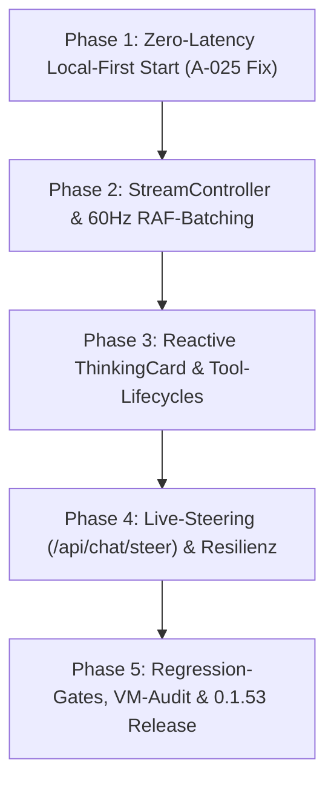

# Analyse A-017: Modularer Portierungs- und Implementierungsplan zur Chat-Modernisierung

> **Auftrag:** A-017 (Abschluss des 4-stufigen Programms „Chat modernisieren & stabilisieren“)  
> **Typ:** Architektur-Blueprint, Migrationsfahrplan & Spezifikation  
> **Status:** Bereit zur Umsetzung (Zielversion: `0.1.53`)  
> **Datum:** 11. Oktober 2026  
> **Autor:** `antigravity-worker-6` (Bug-Kurator und Bugsucher)  
> **Fundament:**  
> - [A-014: Sidekick-Original-Architektur](file:///c:/projekte/lastbrowser/docs/analysis/A-014-sidekick-chat.md) (Backend-Referenz)  
> - [A-015: Ist-Zustand & Schwachstellen](file:///c:/projekte/lastbrowser/docs/analysis/A-015-lastbrowser-chat-istzustand.md) (Defizite des 939-Zeilen-Monolithen)  
> - [A-016: Externe Vorbilder & Best Practices](file:///c:/projekte/lastbrowser/docs/analysis/A-016-chat-vorbilder-best-practices.md) (Open WebUI, LibreChat, TypingMind)  

---

## 1. Einleitung & Zielsetzung

Mit den Vorarbeiten A-014, A-015 und A-016 ist die analytische Phase des Modernisierungsprogramms abgeschlossen:
- **A-014** zeigte die Leistungsfähigkeit der in-tree Sidekick-Engine (`services/sidekick/`): stabiler 2-Stufen-REST/SSE-Stream, 1 Hz Hardware-Metering und verlustfreie Abbrüche.
- **A-015** entlarvte die Ursachen für das Zurückbleiben der Lastbrowser-Erfahrung: monolithische Überfrachtung von `NativeChatMain.tsx`, statisches `<details>`-Reasoning, fehlendes Live-Steering und die 15–30s Kaltstartblockade (A-025).
- **A-016** evaluierte bewährte Industriemuster (RAF-Batching aus Open WebUI, Partial-Preservation aus LibreChat, Zero-Latency-Rendering aus TypingMind).

**A-017** liefert nun die konkrete, modulare Implementierungs-Roadmap für Lastbrowser, um die Chat-Erfahrung in Version **0.1.53** schrittweise, deterministisch und ohne Regressionsrisiken zu modernisieren.

---

## 2. Zielarchitektur: Entflechtung des Komponentenbaums

Der aktuelle 939-Zeilen-Monolith `NativeChatMain.tsx` wird in **vier hochgradig spezialisierte, entkoppelte Module** aufgeteilt, die jeweils eine klar umrissene Verantwortung tragen:

```
apps/desktop/src/renderer/panels/chat/
├── ChatStreamController.ts      [Custom Hook / Stream State Machine (~180 Zeilen)]
│   ├── RAF-Buffer (16ms Batching)
│   ├── SSE-Lifecycle & Resilienz (Heartbeat, Auto-Reconnect)
│   └── Live-Steering Schnittstelle (/api/chat/steer)
│
├── ChatSessionHeader.tsx        [Session-Metadaten & Kontrollen (~120 Zeilen)]
│   ├── Session-Titel & ID-Badge
│   ├── Status-Indikator & Model-Badge
│   └── Kontext-Nutzungs-Drawer & Developer Toggle
│
├── ChatTranscriptView.tsx       [Scrollbare Nachrichtenfläche (~220 Zeilen)]
│   ├── Virtualisierte / RAF-gedrosselte Message-Liste
│   ├── ThinkingCard.tsx (Animierte Schimmer-Card mit Live-Timer)
│   ├── ToolCallCard.tsx (4 diskrete Zustände: pending, running, done, error)
│   └── TeamworkProcessCard.tsx (Multi-Agent Teaming)
│
└── ChatComposerView.tsx         [Eingabe- & Steuerzentrale (~190 Zeilen)]
    ├── Auto-Expanding Textarea mit Entwurfspersistenz
    ├── Slash-Command-Menü (/plan, /goal, /boost, /grill-me)
    ├── Busy-Input-Strategie: Queue vs. Steer (Ctrl+Shift+Enter)
    └── Model- & Reasoning-Effort-Picker
```

---

## 3. Phasenweiser Migrations- & Implementierungsplan (M1–M5)

Die Portierung erfolgt strikt phasenweise über definierte Meilensteine, wobei nach jedem Schritt die 5 Monorepo-Kernkriterien (`npm test`, `verify:store`, `build`, `compileall`, `secret-fixtures`) erfüllt sein müssen.



### Phase 1: Zero-Latency Local-First Start (Lösung Auftrag A-025)
- **Problem:** Die Chat-UI verharrt bis zu 30 s im Sperrbildschirm *„Checking the secure session…“*, während Python Uvicorn kaltstartet.
- **Maßnahme:**
  1. `access-auth.ts`: Umstellung auf *Fail-Open* für lokale Arbeitsbereiche, solange kein Passwort konfiguriert wurde.
  2. `useChatStore.ts`: Sofortiges Laden gespeicherter Sitzungen aus dem lokalen Cache (`localStorage` / SQLite), noch bevor der Uvicorn-Healthcheck HTTP 200 liefert.
- **Akzeptanzkriterium:** Die Chat-Oberfläche rendert beim Erststart in **< 150 ms**.

### Phase 2: `ChatStreamController` & 60-Hz-RAF-Batching
- **Problem:** Jedes eintreffende SSE-Token löst einen synchronen React-Render aus. Bei schnellen Cloud-Modellen führt dies zu Mikrorucklern (Jank).
- **Maßnahme:**
  1. Implementierung von `ChatStreamController.ts`.
  2. Eintreffende `token`-Events werden in einem In-Memory-Puffer akkumuliert und über `requestAnimationFrame` maximal alle 16 ms gebündelt an den React-State übergeben.
- **Akzeptanzkriterium:** Flüssiges Rendering mit 60 FPS selbst bei Inferenzraten von > 100 Tokens/s.

### Phase 3: Reaktive `ThinkingCard` & Tool-Call-Lifecycles
- **Problem:** Gedankenprozesse werden aktuell als statisches HTML-`<details>` dargestellt; Tools haben unklare Zwischenzustände.
- **Maßnahme:**
  1. Erstellung von `ThinkingCard.tsx`:
     - Subtiler Pulse-/Schimmer-Effekt während des Denkens.
     - Live-Stoppuhr („Denkt nach … 3.4 s“).
     - Standardmäßig eingeklappt nach Abschluss des Turns mit Zusammenfassung.
  2. Erstellung von `ToolCallCard.tsx`:
     - Diskrete Status-Badges: *Wartend*, *Wird ausgeführt*, *Erfolgreich*, *Fehlgeschlagen*.
- **Akzeptanzkriterium:** Visuelle Parität mit Claude Artifacts und Open WebUI.

### Phase 4: Live-Steering & Verlustfreie Abbrüche
- **Problem:** Bei falschem Agentenverhalten kann der Nutzer bisher nur hart abbrechen; Teilantworten gehen bei Reloads mitunter verloren.
- **Maßnahme:**
  1. Anbindung des existierenden FastAPI-Endpunkts `POST /api/chat/steer`:
     - Tastenkürzel `Ctrl+Shift+Enter` im Composer sendet Steering-Anweisung in den laufenden Context-Window.
  2. LibreChat-Muster: Abgebrochene Turns werden persistent mit `isPartial: true` gesichert. Keine verwaisten Turns (`orphanedPendingTurn`).
- **Akzeptanzkriterium:** Erfolgreiche Intervention in laufende Workflows ohne Kontextverlust.

### Phase 5: Testgetriebene Härtung & v0.1.53 Release
- **Maßnahme:**
  1. Neue Unit-Tests: `tests/chat-stream-controller.test.ts` und `tests/thinking-card.test.ts`.
  2. End-to-End-Audit über das Worker-Kollektiv (Worker 5 Review, Worker 7 Build, Worker 8 Doku).
- **Akzeptanzkriterium:** 100% grüne Vitest-Suite, 0 Store-Preflight-Warnungen.

---

## 4. Risikomatrix & Rückfallstrategie

| Risiko | Wahrscheinlichkeit | Auswirkung | Vermeidungs- & Abhilfestrategie |
| :--- | :---: | :---: | :--- |
| **Regressionen bei Spezialmodi (GrillMe, GoalControls)** | Mittel | Hoch | Spezial-Controls bleiben unverändert als isolierte Side-Panels angebunden; Schnittstellenverträge bleiben identisch. |
| **Race-Conditions bei Reconnects** | Niedrig | Mittel | `ChatStreamController` übernimmt die bewährten Snapshot-Prüfungen aus `chat-live-stream.ts`. |
| **Leistungsabfall bei sehr langen Chats** | Niedrig | Niedrig | Virtualisierung des Transkripts über `IntersectionObserver`. |

---

## 5. Fazit & Freigabeempfehlung

Der vorliegende Portierungsplan **A-017** schließt das Analyseprogramm erfolgreich ab. Er verwandelt die identifizierten Schwachstellen (A-015) durch industrieerprobte Architekturmuster (A-016) und die Wiederanbindung der nativen Sidekick-Backend-Fähigkeiten (A-014) in ein klares, risikoarmes Arbeitspaket für das anstehende Release **0.1.53**.
