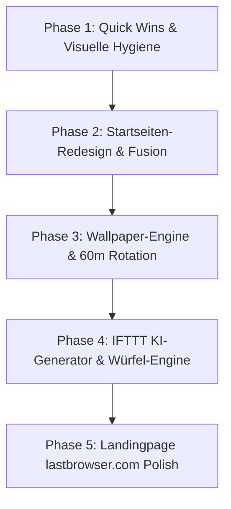

# LastBrowser — Master UI/UX Design-Spezifikation & Zielbild

> **Status:** Final abgenommenes Konzept & Design-Zielbild  
> **Architektur-Richtlinie:** DSGVO-konform, 100% Local-First, Wahrung des bestehenden LastBrowser-Brandings  
> **Version:** 1.0 (Ready for Implementation)

---

## 1. Executive Summary & Designphilosophie

LastBrowser behält seine etablierte, professionelle Benutzeroberfläche in tiefem Midnight-Navy (`#07111f`) bei. Das Redesign fokussiert sich auf die Startseite (New Tab Page / Dashboard) und die Landingpage (`lastbrowser.com`), um kognitive Überlastung zu beseitigen und den Browser in eine Oase der Ruhe und Produktivität zu verwandeln.

### Die Kernpfeiler des Zielbilds:
1. **Bestehende LastBrowser-Shell:** Sidebar-Ergonomie, ConPTY-Terminal, Workspace-Isolation und Tab-Management bleiben in ihrer Struktur erhalten.
2. **Die Startseite als Luminous Launchpad:**
   - Sanfte, kreisförmige **Luminous Aura** im oberen Bereich.
   - **Eine einzige, zentrierte Omnibox** (`Ask Nova or enter URL...`) mit Intent-Erkennung.
   - **Contextual Spatial Resume Shelf:** Drei schwebende Glas-Karten mit Tab-Miniaturansichten zum 1-Klick-Wiederaufnehmen der letzten produktiven Sessions.
   - **Vektor-Speed-Dial:** Scharfe Marken-Favicons am Fuß der Seite.
3. **Erweiterte Wallpaper-Engine mit IFTTT & Würfel (🎲):**
   - 6 kuratierte, vorinstallierte Wallpaper mit automatischer 60-Minuten-Rotation und manuellem Durchschalten per dezenter Eck-Pfeile (`[ ‹ ] [ › ]`).
   - Bedingter KI-Bildgenerator (aktiviert nur bei vorhandenem Bildmodell) inklusive modularer Keyword-Zufalls-Engine mit kreativen und absurden Prompts.

---

## 2. Visuelle Spezifikation der Startseite (New Tab Page)

### 2.1 Layout-Zonierung (Vertikaler Rhythmus)

```
┌─────────────────────────────────────────────────────────────────────────────┐
│ LASTBROWSER SHELL                                                           │
├───────────────┬─────────────────────────────────────────────────────────────┤
│ Vertikale     │ [ZONE 1: ATMOSPHERISCHE AURA & BEGRÜSSUNG]                  │
│ Sidebar       │ • Subtiler kreisförmiger Aura-Glow (Cyan/Violett)           │
│ (Links, 240px)│ • 03:48 Uhr | "Welcome back, Maximilian. Pick up where..."  │
│               │                                                             │
│ • Pinned Apps │ [ZONE 2: ADAPTIVE PROMPT & OMNIBOX]                         │
│ • Spaces      │ • Zentrierte Leiste: "Ask Nova or enter URL..."             │
│ • Tabs        │ • Quick Action Chips: [✨ Recherche] [⚡ Tabs zusammenfassen]│
│ • Tools       │                                                             │
│ • Settings    │ [ZONE 3: CONTEXTUAL SPATIAL RESUME SHELF]                   │
│               │ • 3 Glas-Cards: [Dev Sprint] [AI Research] [Personal]       │
│               │ • Miniatur-Vorschaukacheln der Tabs + "Resume Session" CTA │
│               │                                                             │
│               │ [ZONE 4: SPEED DIAL & MINIMAL DOCK]                         │
│               │ • Vektor-Favicons: GitHub, Google, Reddit, YouTube          │
│               │ • Unten Rechts: [ ‹ ] [ › ] Wallpaper-Pfeile + [ 🎨 Settings]│
└───────────────┴─────────────────────────────────────────────────────────────┘
```

### 2.2 Farb- & Kontrast-Tokens

| Token-Name | Hex / RGBA | Verwendungszweck |
| :--- | :--- | :--- |
| `--lb-bg-base` | `#07111F` | Fester Hintergrundgrundton |
| `--lb-surface-glass` | `rgba(16, 24, 39, 0.72)` | Glas-Karten (Backdrop-Filter: Blur 24px) |
| `--lb-border-glass` | `rgba(255, 255, 255, 0.08)` | Subtile 1px-Kantenbeleuchtung |
| `--lb-accent-primary` | `#00E5FF` | Elektro-Cyan für primäre Indikatoren |
| `--lb-accent-ai` | `#8B5CF6` | Laser-Violett für Nova KI-Funktionen |
| `--lb-accent-safety` | `#10B981` | Smaragdgrün für Isolation & Shields |
| `--lb-text-main` | `#F8FAFF` | Headlines & aktive Eingaben |
| `--lb-text-muted` | `rgba(232, 242, 255, 0.65)` | Sekundäre Beschriftungen (WCAG AA konform) |

> [!IMPORTANT]
> **Farbkorrektur-Regel:** Rot/Korallrot ist strikt für destruktive Aktionen (Löschen, Schließen, Fehler) reserviert. Aktive Workspaces, Buttons und Selektionen nutzen ausschließlich Cyan, Smaragd oder Violett.

---

## 3. Das 6-teilige Default-Wallpaper-Bundle (60-Minuten-Zyklus)

Die folgenden 6 hochaufgelösten Hintergründe werden lokal mitgeliefert und rotieren automatisch im 60-Minuten-Takt mit einem weichen 600ms Crossfade-Übergang:

1. **Wallpaper 01 — Liquid Obsidian & Prismatic Waves:**  
   Flüssiges, dunkles Glas mit geschmeidigen Wellen, Chrom-Reflexionen und Kantenbrechung in Cyan und Lila.
2. **Wallpaper 02 — Nordic Arch at Sunset Fjord:**  
   Monolithischer Obsidian-Bogen in ruhigem, nebligem Wasser vor einem warmen Sonnenuntergang.
3. **Wallpaper 03 — Midnight Cyberpunk Street:**  
   Regenfeuchte Großstadtstraße bei Nacht mit satten Zyan- und Magenta-Lichtreflexionen auf nassem Asphalt.
4. **Wallpaper 04 — Bioluminescent Mountain Pine Lake:**  
   Verzauberter Bergsee bei Vollmond mit glimmenden Moos-Partikeln und finsteren Tannen-Silhouetten.
5. **Wallpaper 05 — Deep Space Sapphire Nebula:**  
   Kosmischer Nebel mit feinsten Sternenstaub-Filamenten in Tiefblau, Indigo und Violett.
6. **Wallpaper 06 — Brutalist Monolith & Golden Slit Hall:**  
   Monumentale Architektur mit gigantischen Pfeilern, reflektierendem Wasserbecken und warmen Sonnenstrahlen.

### Steuerung & Ergonomie:
* **Eck-Pfeiltasten (`[ ‹ ] [ › ]`):** Dezent transparent unten rechts neben dem Paletten-Icon; blenden bei Hover auf 85% Opacity auf und schalten Wallpaper sofort um.
* **Hintergrund-Unschärfe (Blur-Slider):** 0px bis 20px Weichzeichner im Settings-Flyout, um den Textkontrast individuell anzupassen.
* **Luminous-Aura-Slider:** Helligkeitsregler von 0% (aus) bis 100% (leuchtender Fokus).

---

## 4. IFTTT KI-Wallpaper-Generator & Zufallswürfel (🎲)

### 4.1 Die Bedingungslogik (IFTTT)
```
WENN (Lokales Modell ODER Cloud-API unterstützt Bildgenerierung)
DANN:
  Zeige im Settings-Flyout den Bereich "Generate with AI" mit aktiver Status-Badge.
SONST:
  Bereich dezent ausblenden oder Hinweis auf Modelleinstellungen anzeigen.
```

### 4.2 Die modulare Würfel-Matrix (Zufallsgenerator)
Der Zufallswürfel (`🎲`) kombiniert dynamisch 5 Wortgruppen und hängt automatisch strikte Qualitäts- und Kompositions-Guardrails an:

```typescript
export const DICE_PROMPT_ENGINE = {
  subjects: [
    'monolithic obsidian archway',
    'ancient alien server monument covered in moss',
    'cybernetic whale floating through misty skyscraper canyons',
    'geometric floating glass polyhedrons',
    'abandoned retro-futuristic radio telescope',
    'bioluminescent underground crystalline cavern',
    'submerged neon arcade hall under deep calm ocean waters',
    'solitary orbital research station overlooking a planet ring',
    'giant sleeping stone golem overgrown with neon mushrooms',
    // Absurde & humorvolle Einträge:
    'cyberpunk capybara wearing tiny headphones drinking tea',
    'zero-gravity floating rubber duck made of dark matter and stars',
    'medieval knight in full armor debugging code in a foggy forest',
    'giant disco ball acting as the moon over an empty sand desert',
    'retro 1980s CRT monitor half-buried in a mossy mountain ridge',
    'surreal floating ramen bowl emitting faint holographic steam'
  ],
  environments: [
    'in an endless rainy neo-noir alleyway with wet asphalt',
    'standing in calm misty Nordic fjord waters at twilight',
    'in a vast dark brutalist concrete hall with light slits',
    'on a tranquil moonlit mountain lake surrounded by pine silhouettes',
    'floating in deep sapphire cosmic dust and stellar filaments',
    'inside a silent overgrown glass greenhouse at dawn',
    'on an infinite obsidian mirror floor reflecting distant lightning'
  ],
  lighting: [
    'soft ambient cyan and laser-violet neon glow',
    'warm golden hour volumetric light rays piercing dense fog',
    'moody low-contrast cinematic OLED lighting with deep shadows',
    'gentle glowing bioluminescent spore particles in the air',
    'macro studio edge lighting with faint prismatic dispersion'
  ],
  materials: [
    'dark translucent frosted glass and liquid mercury',
    'weathered brutalist concrete and obsidian stone',
    'iridescent dark silk waves and polished titanium',
    'wet asphalt with oil-slick rainbow reflections'
  ],
  guardrails: 'cinematic wide desktop wallpaper, ample clean negative space in the center for UI overlays, shallow depth of field, 8k resolution, low visual clutter, no text, no watermarks --ar 16:9'
};
```

---

## 5. Priorisierte Umsetzungs-Roadmap



### Phase 1: Quick Wins & Visuelle Hygiene (Aufwand: ca. 1 Tag)
* **Semantische Akzentfarbe korrigieren:** Rot aus dem aktiven Space-Rahmen und dem „Open“-Button entfernen; Umstellung auf Cyan/Indigo.
* **Logo-Seitenverhältnis fixen:** Feste Dimensionierung (`width: 36px; height: 36px; object-fit: contain;`) in `NativeBrowserStartPage.tsx`.
* **Redundante „+ New Tab“-Buttons bereinigen:** Vereinheitlichung auf die Kopfzeile der Tabliste.
* **Pfad-Maskierung bei Spaces:** Dateisystempfade wie `H:\` mit einem sauberen Display-Namen versehen.
* **Landingpage:** Fehlertext *„Downloadzahl derzeit nicht verfügbar“* ausblenden und macOS-Traffic-Lights durch Windows-11-Fenstergeometrie ersetzen.

### Phase 2: Startseiten-Redesign (Aufwand: ca. 2 Tage)
* **Luminous Aura & Hero-Bereich:** Implementierung des atmosphärischen Glow-Hintergrunds und Straffung der vertikalen Abstände.
* **Vereinheitlichte Omnibox:** Verschmelzung der doppelten Suchleisten zu einer einzigen Intent-Eingabezeile.
* **Spatial Resume Shelf:** Komponenten-Entwicklung der 3 Session-Karten mit Tab-Miniaturansichten und Ein-Klick-Wiederaufnahme.
* **Vektor-Speed-Dial:** Austausch der Textkürzel durch hochauflösende Vektor-Favicons.

### Phase 3: Wallpaper-Engine & Rotation (Aufwand: ca. 1 Tag)
* Einbindung der 6 Bilddateien in das Asset-Verzeichnis.
* Implementierung des 60-Minuten-Intervall-Schedulers mit weichem 600ms Crossfade.
* Einbau der dezenten Eck-Pfeiltasten `[ ‹ ] [ › ]` für den manuellen Wechsel.
* Einstellungen-Flyout mit Galerie, Farbwähler und Blur-/Aura-Schiebereglern.

### Phase 4: IFTTT KI-Generator & Würfel (Aufwand: ca. 1–2 Tage)
* Anbindung an die Sidekick-Modell-API zur Prüfung von `hasImageGeneration`.
* Dialog-Eingabebalken im Settings-Panel mit Würfel-Button `[ 🎲 ]`.
* Integration der Zufalls-Matrix zur dynamischen Prompt-Erstellung.
* Lokales Speichern der generierten Bilder in `%APPDATA%\Lastbrowser\wallpapers`.

### Phase 5: Landingpage-Redesign (`lastbrowser.com`) (Aufwand: ca. 1 Tag)
* Schärfung der Value Proposition: Fokus auf Geschwindigkeit, Privatsphäre und lokale KI.
* Bereinigung des Entwickler-Jargons (Widevine, ConPTY).
* Integration des modernen Hero-Showcases mit Windows 11 Fluent-Material.

---

## 6. Fazit

Dieses Dokument dient als die verbindliche Blaupause für alle nachfolgenden Entwicklungs- und Styling-Schritte. Alle Entscheidungen sind vollständig mit dem bestehenden Codebestand und den Architekturrichtlinien von LastBrowser abgestimmt.
