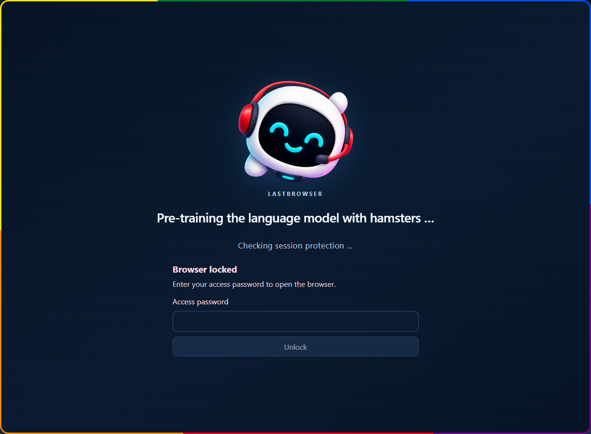
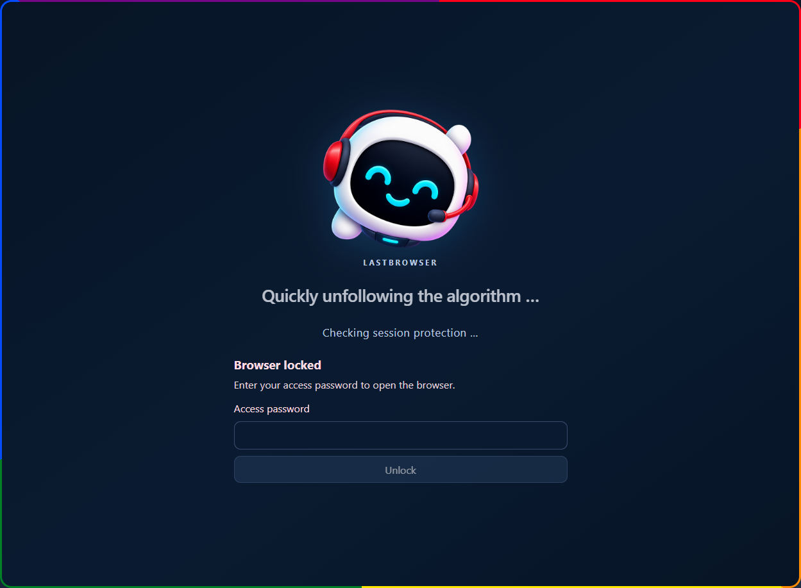
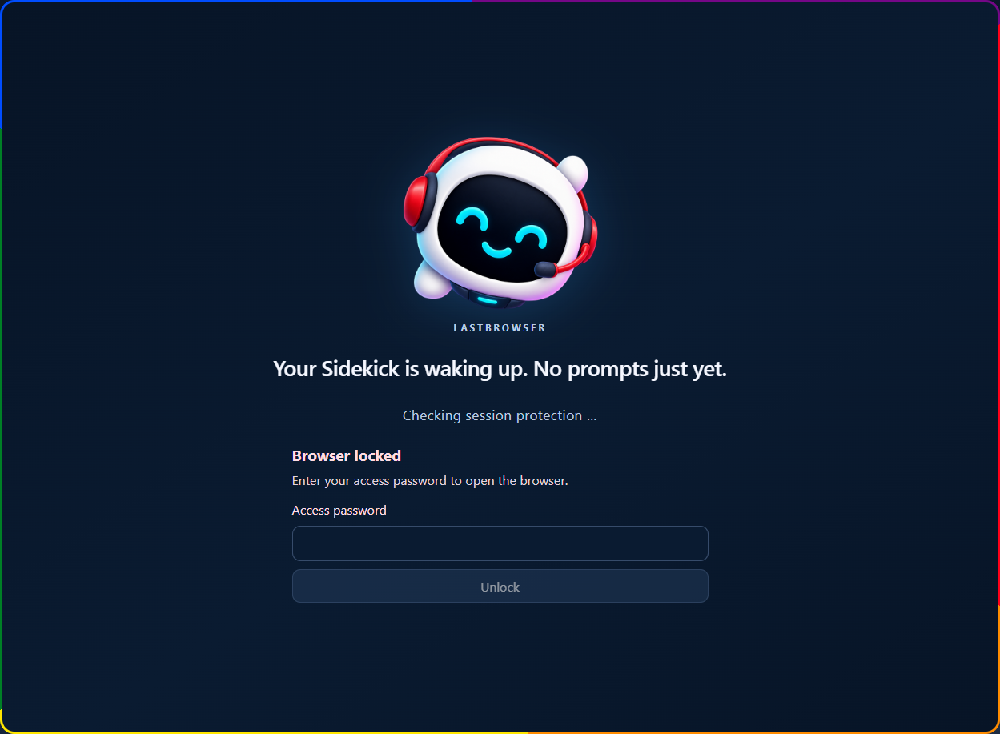
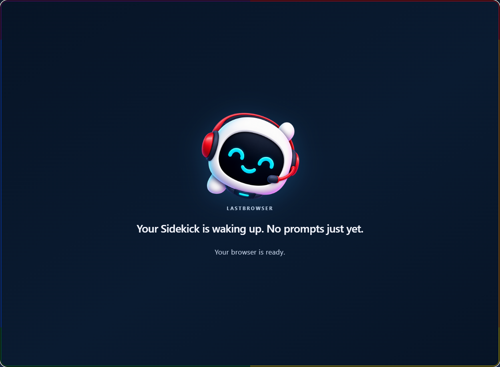
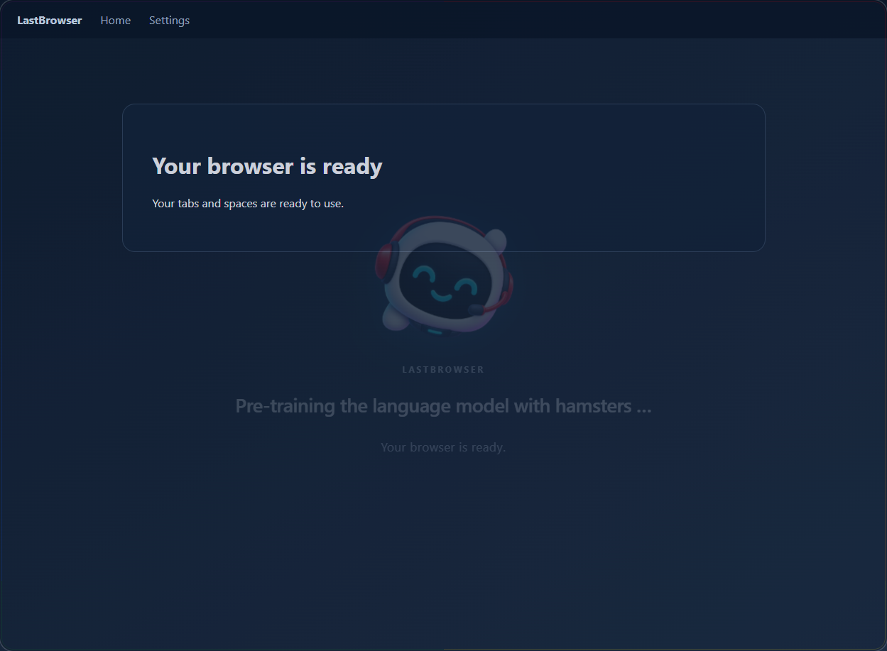
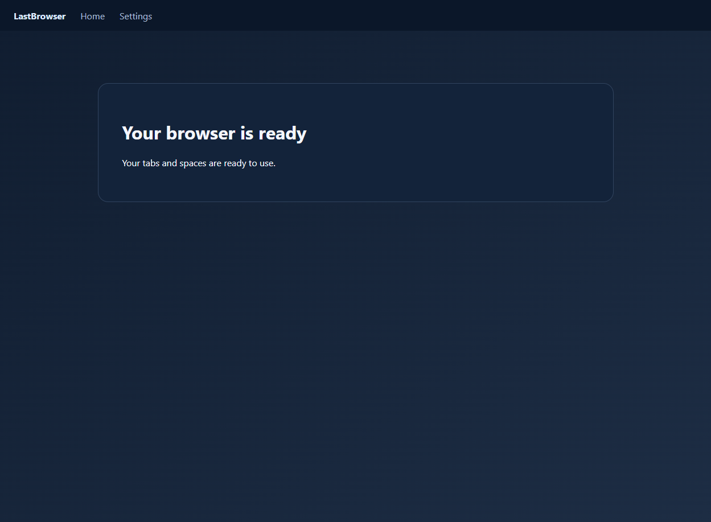
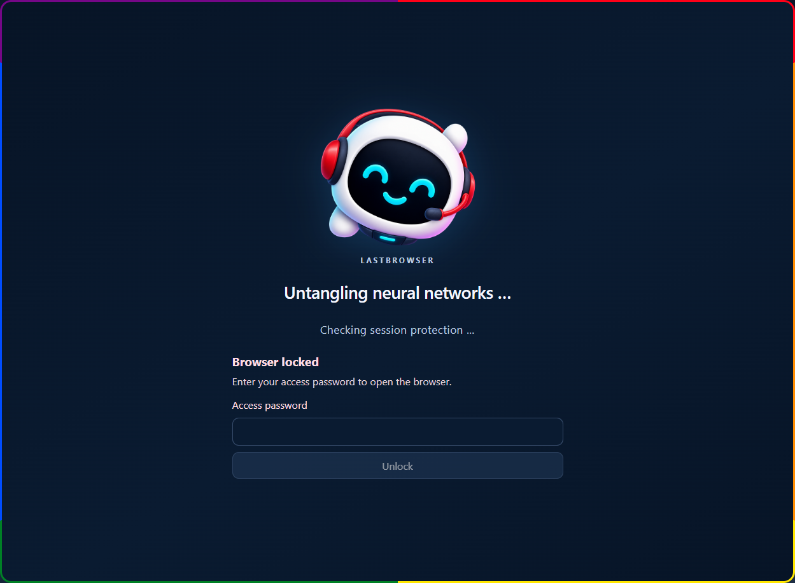

# A-025 startup Pride frame and password opening

## Behavior

- The loading screen keeps the existing mascot assets and copy. A compact radial glow pulses behind the mascot.
- A three-pixel frame carries six equal Pride colors: red, orange, yellow, green, blue, and violet. The colors travel around the rounded outer edge. The background has no moving light cone.
- A verified login starts a 650 ms opening only when password protection was active at submission and the response confirms `auth_enabled: true` plus `logged_in: true`.
- The pending opening waits for the existing auth gate, `startupPhase === 'ready'`, and the existing ready acknowledgement. During the transition the app shell stays inert and hidden from assistive technology. Focus moves to the overlay, then to the app shell when the overlay finishes.
- A failed login does not dispatch the verified-login transition. Confirmed disabled auth never starts it. Lock, profile change, or auth scope change cancels it. Reduced motion opens directly without running the animation.
- Auth reducer behavior, readiness signals, phase meanings, and browser release conditions are unchanged.

## Visual preview evidence

These are real Chromium renders of the source `StartupScreen` component. The background browser shell in the opening frames is a small synthetic preview fixture; these screenshots do not represent packaged Electron or VM acceptance.

Three loading frames show the six-color edge moving around the window while the dark canvas stays still:

The opening animation was paused through the browser animation API at 0, 300, and 600 ms of its 650 ms duration:

The remaining two frames show the overlay removed after normal completion and the direct reduced-motion transition:

The reduced-motion loading frame keeps the Pride border static while the locked screen remains visible:

## Verification

- Focused auth/readiness/startup suites: 29 tests passed.
- Full repository unit and integration suite: 228 files passed, 2,075 tests passed, 19 skipped.
- Desktop renderer and main-process build passed; Vite reported the existing large JavaScript chunk warning.
- Browser preview checked frame movement, all three controlled opening times, normal completion, and direct reduced-motion completion.
- Store preflight: 39 checks passed, 0 failed, 2 warnings (provisional screenshots and no final package).\n- Desktop renderer and main-process build passed.\n- Python syntax compilation passed.\n- System integration policy suite: 20 tests passed.\n- `git diff --check` passed.
